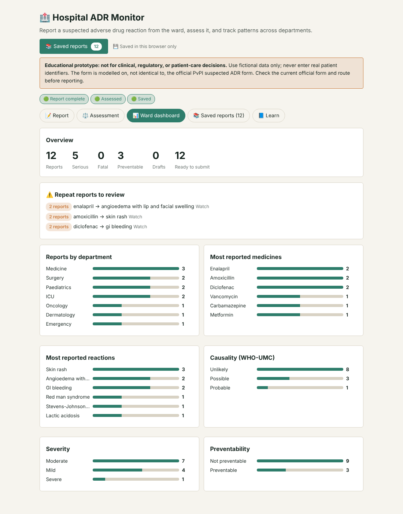

# 🏥 Hospital ADR Monitor

A browser-based tool for a hospital drug safety team: report a suspected adverse drug reaction (ADR) from the ward, assess it, and watch for patterns across departments.

**Live demo:** https://shashank1gawd.github.io/hospital-adr-monitor/

> ⚠️ **Educational prototype. Not for clinical, regulatory or patient-care decisions.** Use fictional data only and never enter real patient identifiers. The form is modelled on, not identical to, the official PvPI suspected ADR form. Always check the current official form and reporting route.

## Why this project

Pharmacovigilance has two sides. Companies and regulators process cases and detect signals in large databases. Hospitals are where reactions are first noticed. A hospital drug safety team has to spot a possible ADR on the ward, document it properly, judge how likely the drug caused it, and pass it up to the national system (PvPI in India), which feeds the WHO global database.

This tool covers that front-line workflow end to end, and it is Project 3 of a three-project pharmacovigilance portfolio:

| Project | What it does |
|---|---|
| 1. [FAERS Signal Detection](https://github.com/Shashank1gawd/faers-signal-detection) | Finds statistical signals (PRR/ROR) in FDA adverse event data |
| 2. [ICSR Case Workbench](https://github.com/Shashank1gawd/icsr-case-workbench) | Processes individual case safety reports: coding, causality, QC, deadlines |
| **3. Hospital ADR Monitor** (this repo) | Hospital-side reporting, assessment and ward-level monitoring |

## Features

- **ADR report form** in four sections (patient, reaction, medicine, reporter) with a live completeness check against the four minimum criteria: identifiable patient, identifiable reporter, suspected medicine, reaction.
- **WHO-UMC causality** assessment (Certain, Probable, Possible, Unlikely, Conditional). The dechallenge answer is prefilled from the dechallenge field.
- **Severity grading** with the Hartwig and Siegel scale (levels 1 to 7, grouped as Mild, Moderate, Severe).
- **Preventability** assessment with seven Schumock and Thornton style questions.
- **Auto-written case summary** that you can copy.
- **Ward dashboard:** totals, reports by department, most reported medicines and reactions, causality, severity and preventability breakdowns.
- **Repeat-report alerts:** the same medicine and reaction reported twice is marked *Watch*; three or more is marked as a cluster to review.
- **Saved reports list** with search, status filter (Draft, Assessed, Submitted), load, delete and CSV export.
- **Handoff to Project 2:** the "To Project 2" button copies a case in the format the ICSR Case Workbench's Signal tab accepts.
- **Learn tab** explaining each concept in plain language.
- Light and dark mode, works on phones.

## How to use it

1. Open the live demo, or download `index.html` and open it in a browser. No installation or internet connection is needed.
2. On the **Report** tab, fill in the form (or press **Fill demo case**), then press **Save report**.
3. On the **Assessment** tab, answer the WHO-UMC questions, choose a severity level and tick any preventability questions that apply. Press **Save report** again.
4. Open the **Ward dashboard** to see the numbers update. Only saved reports are counted.
5. Open **Saved reports** to search, filter, reload, export or mark reports as submitted.

A complete worked example with the expected results is in [docs/DEMO_CASE.md](docs/DEMO_CASE.md).

## How the assessments work

**WHO-UMC causality (simplified):**

| Condition | Result |
|---|---|
| Timing is unknown | Conditional / Unclassified |
| Timing is not plausible | Unlikely |
| Reaction did not improve after stopping the drug | Unlikely |
| Other causes are possible, or response to stopping is unknown | Possible |
| Plausible timing, no other cause, improved on stopping | Probable |
| As above, plus a recognised drug effect and positive rechallenge | Certain |

**Severity (Hartwig and Siegel):** levels 1 to 2 are Mild, 3 to 4b are Moderate, 5 to 7 are Severe.

**Preventability (Schumock and Thornton style):** any "Yes" answer means the ADR is classed as Preventable.

**Report status:** *Draft* until the four minimum items and a severity level are present, then *Assessed*. *Submitted* is set manually.

## Limitations

- **This is a learning tool, not a regulatory system.** It does not submit anything anywhere. "Mark submitted" only changes a label inside the app.
- The WHO-UMC logic and the question wording are simplified versions written for teaching. They are not the official instruments.
- Repeat-report alerts match the exact wording of the medicine and reaction text. There is no MedDRA coding, so "rash" and "skin rash" count as different reactions.
- Reports are stored in your browser (`localStorage`). Clearing site data deletes them, and they do not move between devices. Use **Copy all as CSV** to keep a backup.
- No login, no multi-user access and no audit trail.
- It has been tested with scripted demo cases, not with real hospital users or real workflows.

## Tech

A single static HTML file with plain HTML, CSS and JavaScript. No framework, build step or external dependency. The file also contains optional code for syncing reports to a claude.ai account; this is skipped automatically everywhere else.

## Possible next steps

- MedDRA-style coding for reactions so repeat alerts group properly
- Printable or PDF report summary
- Hospital-wide trend charts over time
- A fuller WHO-UMC implementation with an audit trail

## License

MIT. See [LICENSE](LICENSE).

## Author

Built by [Shashank Gautam](https://github.com/Shashank1gawd) as part of a pharmacovigilance portfolio. Feedback is welcome.
